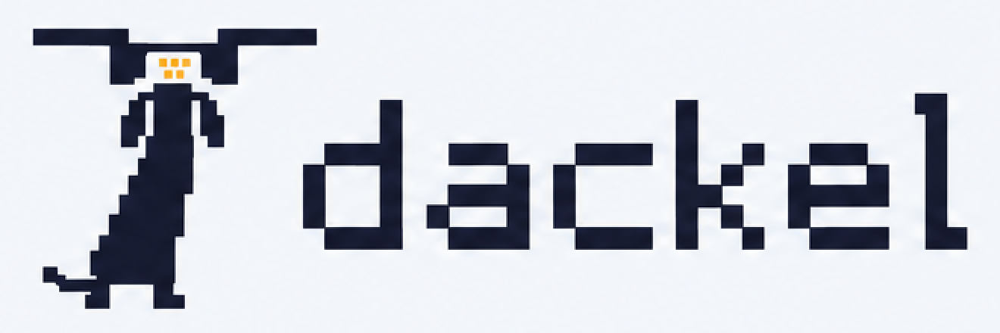

# Hi, I'm Antonio 👋

Computer engineer from Calabria, Italy. I've been writing code since I was 9, and it's still both my job and my hobby.

I run **[SicDev Studio](https://sicdev.it)**, my one-person software studio, and I build my own products alongside client work.

## What I'm building

**[QuantoSpendo](https://quantospendo.app)** · *ForeSpend* outside Italy  
A personal finance app that tells you how much you'll spend before you spend it. It forecasts both expenses and income, and it doesn't profile its users.  
[App Store](https://apps.apple.com/app/id6773628006) · [Google Play](https://play.google.com/store/apps/details?id=it.sicdev.quantospendo)

**[dackel](https://github.com/uSic97/dackel)** 🚧 *work in progress*  
An open source, self-hosted dashboard that keeps all your ad campaigns in one place (Meta, TikTok, Reddit, Telegram and more), with cost per result even when the result happens off the web, like new subscribers to a Telegram channel. AGPL-3.0.  
*Dackel* is German for dachshund: Kali, mine, inspired the name.

## Client work

Through [SicDev Studio](https://sicdev.it) I build custom software for businesses, associations and public administration.

**[OnlyCars](https://onlycars.store)**  
A web showcase for a car dealership, built with Angular and Spring Boot. [Case study](https://sicdev.it/progetti/onlycars-store)

**[Sellia da Scoprire](https://selliadascoprire.com)**  
A web platform that promotes the territory of Sellia, a small town in Calabria, built for the Valle dell'Alli association. [Case study](https://sicdev.it/progetti/sellia-da-scoprire)

## Community

**[AI DevHack Lab](https://ai-devhacklab.it)**  
A non-profit association about AI and software development. I'm a member.

## How I like to build

- Self-hosted and privacy-first, with no vendor lock-in
- Clean architecture and design patterns (I also teach a course on GoF patterns and Angular)
- One coherent stack, from the database to the App Store

## Stack

**Backend** · Java (my favorite) · Spring Boot · PostgreSQL  
**Frontend** · Angular  
**Mobile** · SwiftUI · Kotlin / Jetpack Compose  
**Infra** · Docker · Nginx · GitHub Actions on self-hosted runners

---

Off the clock, I tinker with defensive security.

[a.durante@quantospendo.app](mailto:a.durante@quantospendo.app) · [sicdev.it](https://sicdev.it) · [LinkedIn](https://www.linkedin.com/in/antonio-durante-8b1291247)
